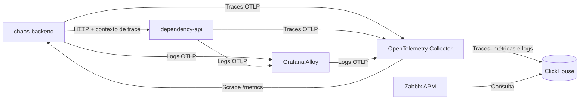

# Zabbix 8 APM — Observabilidade no Kubernetes

Laboratório de SRE para investigar latência e falhas entre duas APIs Python/FastAPI,
correlacionando traces, métricas e logs no Zabbix APM.

As APIs incluem cenários controlados de dependência lenta, indisponibilidade,
erros HTTP e pressão de CPU. A implantação usa charts Helm locais e Helmfile
em um cluster Kubernetes Kind.

## Arquitetura



O caminho ativo grava diretamente no ClickHouse pelo Collector. O proxy Zabbix
também é instalado, mas o envio paralelo ao proxy está desativado
(`exportToProxy: false`). O Alloy recebe logs via OTLP; não faz tail de arquivos
dos containers neste laboratório.

## Cenários da demonstração

| Rota da API principal | Comportamento |
|---|---|
| `/health` | Verificação de disponibilidade |
| `/external-api?scenario=healthy` | Chamada normal entre as duas APIs |
| `/external-api?scenario=slow` | Dependência com atraso de 2,5 segundos |
| `/external-api?scenario=error` | Dependência responde 503; API principal retorna 502 |
| `/slow` | Atraso aleatório entre 1,5 e 4 segundos |
| `/error` | Erro HTTP 500 controlado |
| `/random-failure` | Probabilidade de 30% de resposta HTTP 500 |
| `POST /load-test/cpu-spike` | Processamento de CPU por 3 segundos |
| `POST /load-test/memory-leak` | Alocação de aproximadamente 10 MB por chamada |
| `/metrics/` | Métricas Prometheus de requisições, erros e duração |

## Implementação no Kubernetes

- Deployments para APIs e gateways; duas réplicas da API principal.
- Readiness/liveness probes nas aplicações e requests/limits de CPU e memória.
- Services para comunicação interna, ConfigMaps para configuração e Secrets
  para credenciais de demonstração.
- StatefulSets com PVCs para PostgreSQL e ClickHouse.
- Checksums nos gateways para reiniciar pods quando seus ConfigMaps mudam.
- Releases separados no Helmfile, com dependências declaradas em `needs` e
  valores do ambiente em `environments/kind`.

## Pré-requisitos e compatibilidade

Docker, Kind, kubectl, Helm, Helmfile e Python 3 instalados no host. O contexto
kubectl deve apontar para o cluster do laboratório.

O perfil padrão utiliza Zabbix `alpine-8.0-latest`, Collector `0.162.0`, Alloy
`v1.6.1` e ClickHouse `25.8`. A tag do Zabbix é móvel; confirme a versão em
execução ao reproduzir os resultados.

**Limitação conhecida:** o ClickHouse 25.8 é uma adaptação para o hardware
local, abaixo do mínimo atualmente documentado para o APM do Zabbix 8.0
(26.8.17.4). As duas variantes testadas do ClickHouse 26.8.36.3 encerraram com
SIGILL no nó Intel i7-3770. O 24.8 iniciava, mas falhava nas subconsultas
correlacionadas usadas pelos filtros de Trace ID.

Esse perfil serve para estudo e demonstração, não como combinação homologada
para produção. A compatibilidade deve ser verificada no hardware de destino.

## Subir o laboratório

```bash
git clone https://github.com/VJorgeNeto/Zabbix8_APM.git
cd Zabbix8_APM
kind create cluster --name zabbix
```

Confira a StorageClass do cluster:

```bash
kubectl get storageclass
```

O Kind costuma disponibilizar uma classe chamada `standard`, enquanto
os valores deste projeto esperam uma StorageClass chamada `local-path`.
Se o seu cluster usar outro nome, ajuste `storageClassName` nos valores do
PostgreSQL e ClickHouse antes do deploy.

Construa e carregue as imagens locais, depois aplique os releases:

```bash
bash scripts/build-images.sh
helmfile sync
kubectl -n zabbix get pods,pvc
```

O build carrega as imagens no cluster `zabbix`. Para outro nome, use
`KIND_CLUSTER_NAME=nome bash scripts/build-images.sh`.
`helmfile sync` retorna sem aguardar todos os componentes; confirme o rollout
antes de executar os testes.

## Acessar a interface

Em terminais separados, mantenha os port-forwards:

```bash
kubectl -n zabbix port-forward svc/zabbix-web 8080:8080
```

```bash
kubectl -n zabbix port-forward svc/chaos-app 8000:80
```

Frontend: http://localhost:8080. Login inicial: `Admin` / `zabbix`.
API: http://localhost:8000/docs.

Em **Administration → Data source**, habilite a fonte global:

| Campo | Valor de demonstração |
|---|---|
| URL | `http://zabbix-proxy-clickhouse:8123` |
| Database | `telemetry` |
| Authentication | Username and password |
| Username | `zabbix` |
| Password | `zabbix-telemetry-change-me` |

Use **Test** e salve. O frontend usa o DNS interno do Kubernetes; a URL acima
não deve ser substituída por `localhost`.

Para operar também o proxy, cadastre `zabbix-proxy` em
**Administration → Proxies**, no modo Active, e habilite sua coleta APM.
O fluxo direto Collector → ClickHouse não depende da gravação pelo proxy.

## Gerar dados e investigar

```bash
REQUESTS=8 bash scripts/generate-apm-demo.sh
```

As respostas 500/502 geradas pelo roteiro são intencionais. Em APM → Traces,
limpe os filtros e selecione os últimos 15 minutos:

- `service.name = chaos-backend` para investigar a API principal.
- Atributo de span `demo.scenario = slow` para encontrar a dependência lenta.
- Atributo de span `demo.scenario = error` para acompanhar a falha 503 → 502.

Copie o Trace ID e consulte-o em APM → Logs. Em APM → Metrics, procure os
prefixos `http_requests` e `http_request_duration_seconds` nos tipos Sum e
Histogram. Os atributos das métricas vêm do scrape Prometheus e podem
diferir dos recursos usados nos traces.

## Verificação de ponta a ponta

```bash
bash scripts/verify-apm.sh
bash scripts/verify-apm-api.sh
```

`verify-apm.sh` emite um trace, um contador e um log com identificadores
únicos, e só retorna `APM_OK` ao encontrar os três no ClickHouse.
`verify-apm-api.sh` consulta a API do Zabbix e verifica também o filtro de
Trace ID que exige subconsulta correlacionada. Ele usa a conta padrão do lab.

Exportação aceita pelo SDK e porta TCP aberta não comprovam persistência;
os scripts verificam o armazenamento e a consulta pelo Zabbix separadamente.

## Estrutura

```text
apps/               APIs, instrumentação e Dockerfiles
charts/             Charts locais: Zabbix, APM, APIs, Collector e Alloy
environments/kind/  Valores específicos do laboratório
scripts/            Build, tráfego, verificações, backup e recuperação
docs/               Operação e diagnóstico
helmfile.yaml       Releases e dependências de implantação
```

Os manifests em `apps/chaos-ap/k8s` e seu Docker Compose são exemplos da API
isolada. Para reproduzir a stack APM deste repositório, use o Helmfile raiz.

## Operação e limites

As credenciais versionadas são públicas e exclusivas da demonstração.
Mantenha os serviços internos e utilize port-forward local. Memory leak e
CPU spike são experimentos intencionais; o primeiro pode encerrar o container
por falta de memória. O laboratório não implementa SLOs nem comprova ganhos
de MTTR em produção.

Os procedimentos de recuperação e diagnóstico estão em
[docs/operations.md](docs/operations.md). Screenshots podem ser adicionados
em `docs/images/` após revisar os dados exibidos.
